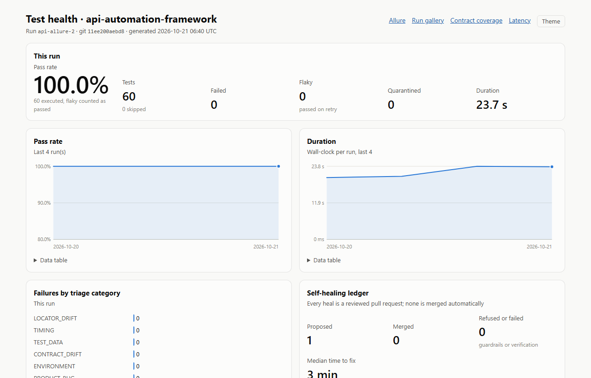
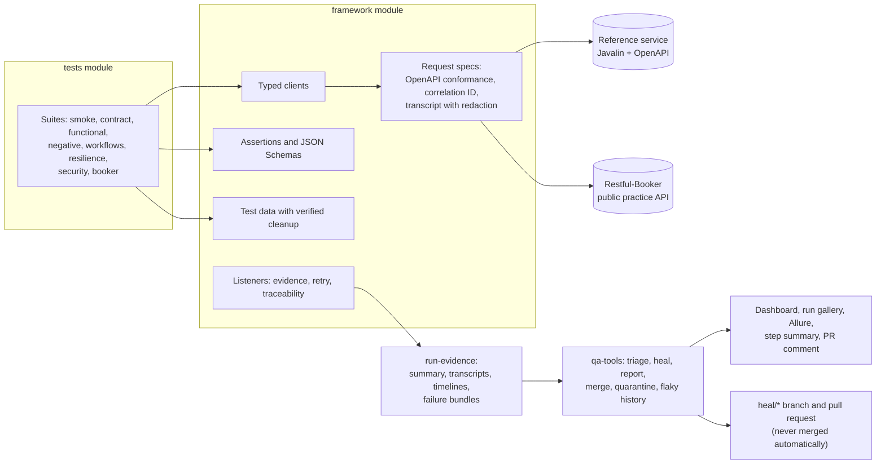

# api-automation-framework

API test automation in Java 21 with REST Assured and TestNG, against a self-hosted reference service
and a public practice API, with failure triage and governed self-healing.

[](https://github.com/kesireddy-kishore-29/api-automation-framework/actions/workflows/ci.yml)
[](https://github.com/kesireddy-kishore-29/api-automation-framework/actions/workflows/nightly.yml)
[](https://kesireddy-kishore-29.github.io/api-automation-framework/)



| | |
|---|---|
| Tests | 60 in the regression (51 in the pull-request gate); all passed in the latest local runs |
| Run time | About 24 s for the regression on a laptop, 4 parallel threads |
| Features traced | 37 of 37 feature IDs have at least one test |
| Postman | 28 requests, 32 assertions, run by Newman |
| Status | Verified locally on Windows 11. The workflows pass actionlint and shellcheck but **have not run on GitHub yet**; the badges turn green only after the first push ([known issues](docs/known-issues.md)) |

## Standards demonstrated

| Practice | Where it is |
|---|---|
| Layered framework: typed clients, request specs, assertions, test data | [`framework/`](framework/) |
| Two contract layers: the provider's OpenAPI document on every response, plus consumer JSON Schemas | [`ContractConformanceFilter`](framework/src/main/java/com/kishore/qa/framework/core/ContractConformanceFilter.java), [`schemas/`](framework/src/main/resources/schemas/) |
| Custom AssertJ assertions (`assertThatResponse(...).matchesContract(...)`) | [`ResponseAssert`](framework/src/main/java/com/kishore/qa/framework/assertions/ResponseAssert.java) |
| Idempotency, retries with backoff, timeouts, rate limits | `resilience` and `negative` suites, [`RetryPolicy`](framework/src/main/java/com/kishore/qa/framework/core/RetryPolicy.java) |
| Authorization across two real actors | [`MultiActorConversationTest`](tests/src/test/java/com/kishore/qa/tests/workflows/MultiActorConversationTest.java) |
| Test data created per test and verifiably cleaned up | [`TestAccount`](framework/src/main/java/com/kishore/qa/framework/data/TestAccount.java), [`ManagedBooking`](framework/src/main/java/com/kishore/qa/framework/data/ManagedBooking.java) |
| Configuration validated at start-up, every problem reported at once | [`ConfigLoader`](framework/src/main/java/com/kishore/qa/framework/config/ConfigLoader.java) |
| Secrets masked in every artifact | [`Redactor`](framework/src/main/java/com/kishore/qa/framework/core/Redactor.java) |
| Failure evidence: transcript, timeline, failure bundle, run gallery | [docs/reporting.md](docs/reporting.md) |
| Triage into seven categories, rules first | [`tools/…/triage`](tools/src/main/java/com/kishore/qa/tools/triage/) |
| Self-healing with guardrails in code, never auto-merged | [docs/self-healing.md](docs/self-healing.md) |
| Health dashboard, Allure with history, contract coverage, latency | [docs/reporting.md](docs/reporting.md) |
| Flaky tests and quarantine with owners and expiry dates | [`quarantine.json`](quarantine.json), [test strategy](docs/test-strategy.md#flaky-tests-and-quarantine) |
| Requirements traceability | [`features.json`](features.json) and `@Feature` on every test |
| Postman collection run by Newman | [`postman/`](postman/), [when to use which](docs/test-strategy.md#postman-or-code) |
| CI: pull-request gate, sharded nightly, Pages, heal workflow | [`.github/workflows/`](.github/workflows/) |
| Quality gates | Spotless, Checkstyle, `-Werror`, Maven Enforcer, Conventional Commits, a 2 MB file guard |

## Architecture



## What is tested

| Suite | Tests | What it covers |
|---|---|---|
| `smoke` | 2 | The service is up; a full sign-up, token and read works |
| `contract` | 4 | Responses match the OpenAPI document and the consumer schemas |
| `functional` | 6 | Accounts, profile updates, public lookups |
| `negative` | 16 | Every error is RFC 7807 problem JSON with the right status (data-driven) |
| `workflows` | 8 | Two actors in one conversation, ledger consistency, home-region routing |
| `resilience` | 7 | Idempotent purchases under retries and concurrency, timeouts, 503 with Retry-After |
| `security` | 8 | Security headers, authorization boundaries, CORS, rate limits |
| `booker` | 9 | CRUD on Restful-Booker with tokens; nightly only, never in the pull-request gate |

Run on its own, the `smoke` suite also picks up smoke-tagged tests from other packages (6 in total).

## Traceability

Every test carries `@Feature` IDs from [`features.json`](features.json). "Tests" counts the test
methods that cover an area (a data-driven method counts once). The dashboard shows the full matrix ([example](docs/examples/dashboard/dashboard-light.png)).

| Area | Features | Covered | Tests |
|---|---|---|---|
| Health (`HEALTH`) | 1 | 1 | 1 |
| Accounts (`ACCT`) | 3 | 3 | 7 |
| Contracts (`CONTRACT`) | 2 | 2 | 4 |
| Errors (`ERR`) | 1 | 1 | 10 |
| Authorization (`AUTHZ`) | 1 | 1 | 4 |
| Conversations (`CONV`) | 3 | 3 | 4 |
| Idempotency (`IDEMP`) | 3 | 3 | 6 |
| Rate limits (`RATE`) | 1 | 1 | 1 |
| CORS (`CORS`) | 2 | 2 | 3 |
| Ledger (`LEDGER`) | 3 | 3 | 3 |
| Regions (`REGION`) | 3 | 3 | 4 |
| Security (`SEC`) | 3 | 3 | 3 |
| Resilience (`RES`) | 3 | 3 | 3 |
| Restful-Booker auth, CRUD, 404 (`AUTH`, `BOOK`, `NEG`) | 7 | 7 | 8 |
| Deliberate-failure demo (`DEMO`) | 1 | 1 | 4 |
| **Total** | **37** | **37** | |

## Design decisions

- A self-hosted reference service is the main target; the public API never gates a merge
  ([ADR 1](docs/adr/0001-self-hosted-reference-service.md), [ADR 8](docs/adr/0008-public-targets-never-gate.md)).
- Two contract layers: the provider's OpenAPI document and consumer JSON Schemas ([ADR 2](docs/adr/0002-two-contract-layers.md)).
- Triage by rules first; a model only for what rules cannot place ([ADR 5](docs/adr/0005-rules-first-triage.md)).
- Healing proposes pull requests; people merge ([ADR 6](docs/adr/0006-governed-self-healing.md)).
- API tests record transcripts and timelines, not video ([ADR 11](docs/adr/0011-transcripts-instead-of-video.md)).
- Java, REST Assured and TestNG from a job-market analysis, one repository per stack
  ([ADR 9](docs/adr/0009-why-java-rest-assured-testng.md)); Postman alongside ([ADR 10](docs/adr/0010-postman-alongside-coded-suites.md)).

All eleven decisions: [docs/adr/](docs/adr/).

## Self-healing

A real run: the service renamed `balance` to `availableBalance` and published the change. The pull-request
gate failed 8 of 51 tests; triage put all 8 in `CONTRACT_DRIFT` with one cause; the rule-based healer
proposed one two-line fix (consumer schema and client model); the guardrails passed; the verifier
ran the lead test 3 times, its suite and the 7 other failures; and the gate passed 51/51 on the heal
branch. Nothing was merged. Every artifact is in
[docs/examples/self-healing-demo](docs/examples/self-healing-demo/); how it works is in
[docs/self-healing.md](docs/self-healing.md).

## Failure evidence

`RECORD_MODE` decides how much each test keeps: `failures` (pull requests, the default), `all`
(nightly and local analysis), `off`. A failed test's attempts become a failure bundle with the call
transcript, the timeline and, after triage, a one-page report. The `demo-failure` suite fails on
purpose, one test per failure path; a bundle from a real run of it is in
[docs/examples/failure-evidence](docs/examples/failure-evidence/).

## Real-world origin

The kinds of scenarios here (sign-up and tokens, people messaging each other, a credit balance with
idempotent purchases, rate limits, browser-facing CORS) come from the author's own production
project, [dotstrap](https://dotstrap.com). Everything in this repository is rebuilt from scratch
against the self-hosted reference service and a public practice API. No dotstrap code,
configuration or data is used, and its private backend is never called.

## Family of repos

- **api-automation-framework** (this one): the API flagship.
- [**ui-automation-framework**](https://github.com/kesireddy-kishore-29/ui-automation-framework): the UI flagship in Playwright and TypeScript, with the same triage, healing and dashboard (the dashboard template is shared byte for byte).
- [**selenium-java-ui-framework**](https://github.com/kesireddy-kishore-29/selenium-java-ui-framework): the same Sauce Demo scenarios as the UI flagship in Selenium 4 and Java, with the same feature IDs and evidence layout.
- [**python-pytest-automation-framework**](https://github.com/kesireddy-kishore-29/python-pytest-automation-framework): API and UI tests in Python; its API tests reuse this repository's reference service in CI.

## How to run

You need JDK 21 (Maven comes with the wrapper) and, for the Postman run, Node 22 or later.

```bash
./mvnw -B install -DskipTests                       # build everything
java -jar sut/target/reference-service.jar &        # reference service on :7070
./mvnw verify -pl tests -Dsuite=pr-gate             # the pull-request gate (51 tests)
./mvnw verify -pl tests -Dsuite=regression          # everything, both targets (60 tests)
./mvnw verify -pl tests -Dsuite=demo-failure        # four tests that fail on purpose

java -jar tools/target/qa-tools.jar triage --run run-evidence/api-automation-framework/<run-id>
java -jar tools/target/qa-tools.jar report --run run-evidence/api-automation-framework/<run-id> --out reports/site
scripts/allure-report.sh                             # Allure with trend history
cd postman && npm ci && npm run newman              # the Postman collection
```

Switches: `-Dsuite=<name>`, `RECORD_MODE=failures|all|off`, `RUN_ID=<id>`, `TEST_RETRIES=0..2`,
`-Pci` or `-Pdocker`. More in the [test strategy](docs/test-strategy.md),
[reporting](docs/reporting.md) and [known issues](docs/known-issues.md).
