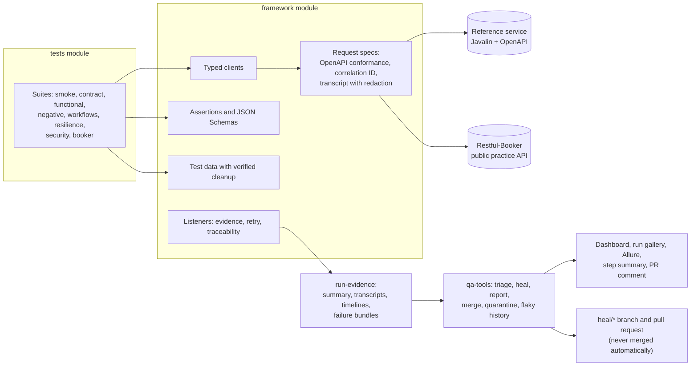

# api-automation-framework

API test automation in Java 21 with REST Assured and TestNG, run against a self-hosted reference
service and a public practice API. Every failure is triaged into one of seven categories. For the
healable ones, a guarded and verified fix is proposed on a branch for a person to review.

| | |
|---|---|
| Tests | 60 in the regression (51 in the pull-request gate), all green in the latest local runs |
| Run time | About 24 s for the regression on a laptop, 4 parallel threads |
| Features traced | 37 of 37 feature IDs have at least one test |
| Postman | 28 requests, 32 assertions, run by Newman |
| Status | Verified locally on Windows 11. The GitHub Actions workflows pass actionlint and shellcheck but have **not run on GitHub yet** ([known issues](docs/known-issues.md)) |

## What a reviewer usually looks for

| Practice | Where it is |
|---|---|
| Layered framework: typed clients, request specs, assertions, test data | [`framework/`](framework/) |
| Two contract layers: the provider's OpenAPI document on every response, plus consumer JSON Schemas | [`ContractConformanceFilter`](framework/src/main/java/com/kishore/qa/framework/core/ContractConformanceFilter.java), [`schemas/`](framework/src/main/resources/schemas/) |
| Idempotency, retries with backoff, timeouts, rate limits | `resilience` and `negative` suites, [`RetryPolicy`](framework/src/main/java/com/kishore/qa/framework/core/RetryPolicy.java) |
| Authorization across two real actors | [`MultiActorConversationTest`](tests/src/test/java/com/kishore/qa/tests/workflows/MultiActorConversationTest.java) |
| Test data created per test and verifiably cleaned up | [`TestAccount`](framework/src/main/java/com/kishore/qa/framework/data/TestAccount.java), [`ManagedBooking`](framework/src/main/java/com/kishore/qa/framework/data/ManagedBooking.java) |
| Secrets masked in every artifact | [`Redactor`](framework/src/main/java/com/kishore/qa/framework/core/Redactor.java) |
| Failure evidence: transcript, timeline, failure bundle, run gallery | [docs/reporting.md](docs/reporting.md) |
| Triage into seven categories, rules first | [`tools/…/triage`](tools/src/main/java/com/kishore/qa/tools/triage/) |
| Self-healing with guardrails in code, never auto-merged | [docs/self-healing.md](docs/self-healing.md), [a real demo](docs/examples/self-healing-demo/) |
| Health dashboard, Allure with history, contract coverage, latency | [docs/reporting.md](docs/reporting.md) |
| Flaky tests and quarantine with owners and expiry dates | [`quarantine.json`](quarantine.json), [test strategy](docs/test-strategy.md#flaky-tests-and-quarantine) |
| Requirements traceability | [`features.json`](features.json) and `@Feature` on every test |
| CI: pull-request gate, sharded nightly, Pages, heal workflow | [`.github/workflows/`](.github/workflows/) |
| Quality gates | Spotless, Checkstyle, `-Werror`, Maven Enforcer, conventional commits, a 2 MB file guard |
| Decisions written down | [docs/adr/](docs/adr/) |

## How it fits together



## Quick start

You need JDK 21. Maven comes with the wrapper (`./mvnw`). Node 22 or later is needed only for the
Postman run.

```bash
./mvnw -B install -DskipTests                       # build everything
java -jar sut/target/reference-service.jar &        # reference service on :7070
./mvnw verify -pl tests -Dsuite=pr-gate             # the pull-request gate (51 tests)
./mvnw verify -pl tests -Dsuite=regression          # everything, both targets (60 tests)
```

| Switch | Effect |
|---|---|
| `-Dsuite=<name>` | One suite: `smoke`, `contract`, `functional`, `negative`, `workflows`, `resilience`, `security`, `booker`, `pr-gate`, `regression`, `quarantine`, `demo-failure` |
| `RECORD_MODE=failures` (default), `all`, `off` | How much evidence each test keeps |
| `RUN_ID=<id>` | Names the run folder under `run-evidence/api-automation-framework/` |
| `TEST_RETRIES=0..2` | Retry cap; 2 by default. A test that passes on a retry is reported as flaky |
| `-Pci`, `-Pdocker` | Environment profile; `local` by default |

After a run:

```bash
java -jar tools/target/qa-tools.jar triage --run run-evidence/api-automation-framework/<run-id>
java -jar tools/target/qa-tools.jar report --run run-evidence/api-automation-framework/<run-id> --out reports/site
scripts/allure-report.sh                             # Allure report with trend history
java -jar tools/target/qa-tools.jar heal --run run-evidence/api-automation-framework/<run-id>
cd postman && npm ci && npm run newman              # the Postman collection
```

`./mvnw verify -pl tests -Dsuite=demo-failure` runs four tests that fail on purpose, one per failure
path, so you can see triage and the failure bundles without breaking anything else.

## Suites

| Suite | Tests in the regression | What it covers |
|---|---|---|
| `smoke` | 2 | The service is up; a full sign-up, token and read works |
| `contract` | 4 | Responses match the OpenAPI document and the consumer schemas |
| `functional` | 6 | Accounts, profile updates, public lookups |
| `negative` | 16 | Every error is RFC 7807 problem JSON with the right status (data-driven) |
| `workflows` | 8 | Two actors in one conversation, ledger consistency, home-region routing |
| `resilience` | 7 | Idempotent purchases under retries and concurrency, timeouts, 503 with Retry-After |
| `security` | 8 | Security headers, authorization boundaries, CORS, rate limits |
| `booker` | 9 | CRUD on Restful-Booker with tokens; nightly only, never in the pull-request gate |

Run on its own, the `smoke` suite also picks up smoke-tagged tests from other packages (6 in total).

## Real-world origin

The kinds of scenarios here (sign-up and tokens, people messaging each other, a credit balance with
idempotent purchases, rate limits, browser-facing CORS) come from the author's own production
project, [dotstrap](https://dotstrap.com). Everything in this repository is rebuilt from scratch
against the self-hosted reference service and a public practice API. No dotstrap code,
configuration or data is used, and its private backend is never called.

## Family of repos

| Repository | Stack | Role |
|---|---|---|
| `api-automation-framework` (this one) | Java 21, REST Assured, TestNG, Postman + Newman | Flagship: API layers, contracts, resilience, self-healing |
| `ui-automation-framework` | TypeScript, Playwright | Flagship: UI, visual, accessibility, performance, self-healing |
| `selenium-java-ui-framework` | Java 21, Selenium 4, TestNG | Lite: the classic page-object stack |
| `python-pytest-automation-framework` | Python, pytest, requests, Playwright | Lite: API and UI in Python |

All four share the same feature-ID style, triage categories, `RECORD_MODE` switch, evidence layout
and JSON formats, so their reports read the same way.

## Repository layout

| Folder | What is in it |
|---|---|
| [`sut/`](sut/) | The reference service: accounts, tokens, conversations, credits, regions, faults and chaos switches |
| [`framework/`](framework/) | The reusable framework: clients, request specs, assertions, schemas, test data, evidence |
| [`tests/`](tests/) | The suites and their TestNG XML files |
| [`tools/`](tools/) | `qa-tools`: triage, heal, report, merge, quarantine check, flaky history |
| [`postman/`](postman/) | The Postman collection and environments for Newman |
| [`config/`](config/) | Checkstyle rules and Allure categories |
| [`scripts/`](scripts/) | Allure report, commit-message check, file-size guard |
| [`docs/`](docs/) | Strategy, decisions, reporting, self-healing, known issues, examples |

## Further reading

[Test strategy](docs/test-strategy.md) · [Self-healing](docs/self-healing.md) ·
[Reporting](docs/reporting.md) · [Decisions](docs/adr/) · [Known issues](docs/known-issues.md) ·
[Examples from real runs](docs/examples/)
