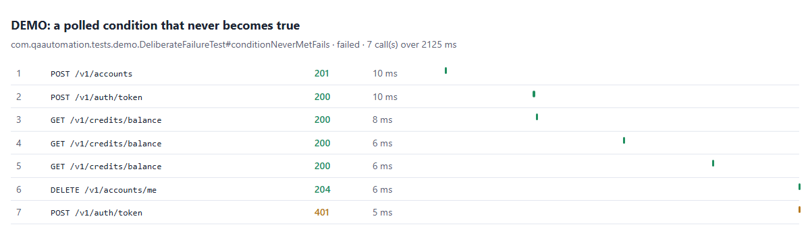
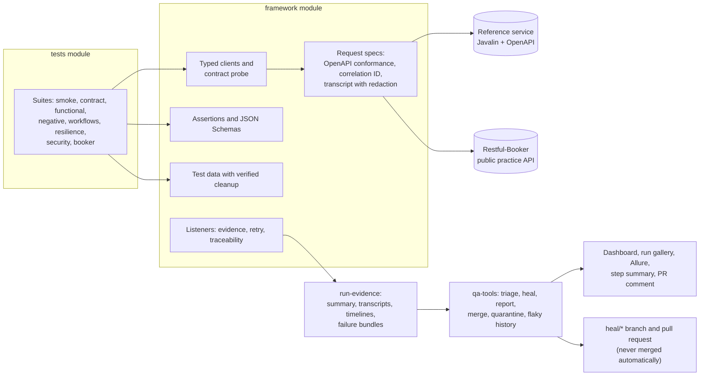

# restassured-testng-api-Dotstrap-Automation

Production-style API test framework: Java 21, REST Assured, TestNG, Postman/Newman, Allure, GitHub
Actions, with every documented response code tested, failure triage and governed self-healing.

[](https://github.com/kesireddy-kishore-29/restassured-testng-api-Dotstrap-Automation/actions/workflows/ci.yml)
[](https://github.com/kesireddy-kishore-29/restassured-testng-api-Dotstrap-Automation/actions/workflows/nightly.yml)
[](https://kesireddy-kishore-29.github.io/restassured-testng-api-Dotstrap-Automation/)
[](LICENSE)
[](pom.xml)
[](pom.xml)
[](pom.xml)

## See it in 60 seconds

- **Live report:** [dashboard](https://kesireddy-kishore-29.github.io/restassured-testng-api-Dotstrap-Automation/)
  and [Allure with trend](https://kesireddy-kishore-29.github.io/restassured-testng-api-Dotstrap-Automation/allure/),
  published by the nightly run. *CI status: first run pending; the images below are from real local
  runs.*
- **If you only have 60 seconds**, open:
  1. [`ErrorContractTest`](tests/src/test/java/com/qaautomation/tests/contract/ErrorContractTest.java):
     every documented error provoked on every operation, each answer checked against the OpenAPI document.
  2. [The self-healing demo](docs/examples/self-healing-demo/): a renamed field fails 9 tests, triage
     finds one cause, one verified fix is proposed, nothing is merged.
  3. [ADR 6, governed self-healing](docs/adr/0006-governed-self-healing.md): why a person still decides.


## At a glance

| | |
|---|---|
| Tests | **124** in the regression across 8 suites, **115** in the pull-request gate, 6 in smoke, 4 deliberate failures in the demo; 26 framework and 71 tooling unit tests |
| Contract coverage | **105 of 105** documented response codes and **19 of 19** operations exercised |
| Features traced | **37 of 37** feature IDs in [`features.json`](features.json) have a test |
| Runs verified | 3 regression runs (`api-allure-4` to `6`), 124/124 each, on 2026-10-22 at commit `2039d00` (Windows 11, JDK 21) |
| Flaky tests | 0 over those 3 runs (the retry listener records any test that passes only on retry) |
| Postman | 28 requests, 32 assertions, 0 failures (Newman, 2026-10-22) |
| Stack | Java 21, REST Assured 5.5, TestNG 7.12, AssertJ, Jackson, Awaitility, Allure 2, Javalin (reference service), Postman/Newman, GitHub Actions |
| What is unusual | OpenAPI conformance on every response; transcripts and timelines instead of video; triage into seven categories; healing that proposes a verified branch and never merges |
| CI status | Workflows pass actionlint and shellcheck; the first run on GitHub is pending ([known issues](docs/known-issues.md)) |

## What's covered

| Suite | What it verifies | Tests | Feature IDs | Folder |
|---|---|---|---|---|
| `smoke` | The service is up; sign-up, token and a read work | 2 (6 with smoke-tagged tests from other suites) | 2 | [smoke/](tests/src/test/java/com/qaautomation/tests/smoke/) |
| `contract` | Responses match consumer JSON Schemas; every documented error on every operation (401, 400/415/422, 403, 404, 402, 429, 503) matches the OpenAPI document | 68 (13 methods, data-driven) | 8 | [contract/](tests/src/test/java/com/qaautomation/tests/contract/) |
| `functional` | Accounts, profile updates, public profiles, conversations | 6 | 6 | [functional/](tests/src/test/java/com/qaautomation/tests/functional/) |
| `negative` | Every error is an RFC 7807 problem with the right status and field | 16 | 6 | [negative/](tests/src/test/java/com/qaautomation/tests/negative/) |
| `workflows` | Two actors in one conversation, ledger consistency, home-region routing | 8 | 9 | [workflows/](tests/src/test/java/com/qaautomation/tests/workflows/) |
| `resilience` | Idempotent purchases under retries and concurrency, client timeouts, 503 with Retry-After | 7 | 5 | [resilience/](tests/src/test/java/com/qaautomation/tests/resilience/) |
| `security` | Security headers, authorization boundaries, CORS, rate limits | 8 | 6 | [security/](tests/src/test/java/com/qaautomation/tests/security/) |
| `booker` | CRUD on the public Restful-Booker API with tokens; nightly only, never in the pull-request gate | 9 | 7 | [booker/](tests/src/test/java/com/qaautomation/tests/booker/) |
| Postman | The same service through a Postman collection run by Newman | 28 requests | – | [postman/](postman/) |

Highlights: contract (OpenAPI on every response plus consumer schemas), idempotency keys,
rate limiting, CORS, a credit ledger that must always sum, multi-region routing, two-actor
authorization, security headers, and a Postman collection beside the coded suites
([when to use which](docs/test-strategy.md#postman-or-code)).

## Run it

Prerequisites: JDK 21 (Maven comes with the wrapper); Node 22+ only for the Postman run.

```bash
./mvnw -B install -DskipTests                             # 1. build everything
java -jar sut/target/reference-service.jar &              # 2. reference service on :7070
./mvnw verify -pl tests -Dsuite=smoke                     # 3. smoke (6 tests)
RUN_ID=local-1 ./mvnw verify -pl tests -Dsuite=regression # 4. full regression (124 tests)
java -jar tools/target/qa-tools.jar report --run run-evidence/restassured-testng-api-Dotstrap-Automation/local-1 --out reports/site  # 5. open reports/site/index.html
```

Windows PowerShell:

```powershell
.\mvnw.cmd -B install -DskipTests
Start-Process java -ArgumentList '-jar', 'sut/target/reference-service.jar'
.\mvnw.cmd verify -pl tests -Dsuite=smoke
$env:RUN_ID = 'local-1'; .\mvnw.cmd verify -pl tests -Dsuite=regression
java -jar tools/target/qa-tools.jar report --run run-evidence/restassured-testng-api-Dotstrap-Automation/local-1 --out reports/site
```

| Run mode | Command (append to `./mvnw verify -pl tests`) | Output |
|---|---|---|
| Smoke | `-Dsuite=smoke` | `run-evidence/restassured-testng-api-Dotstrap-Automation/<run-id>/` |
| Pull-request gate (no public API) | `-Dsuite=pr-gate` | same |
| Full regression | `-Dsuite=regression` | same |
| One suite | `-Dsuite=contract` (or `functional`, `negative`, `workflows`, `resilience`, `security`, `booker`) | same |
| Evidence for every test | `RECORD_MODE=all` before the command (`failures` is the default, `off` keeps none) | `run-evidence/.../<run-id>/` |
| Deliberate-failure demo | `-Dsuite=demo-failure` (4 tests fail on purpose) | failure bundles in `run-evidence/.../<run-id>/failure-bundles/` |
| Postman | `cd postman && npm ci && npm run newman` | `reports/newman/index.html` |

`RUN_ID` names the run folder (a timestamp when unset); `TEST_RETRIES=0..2` sets retries.

## Reports and evidence

| Report | What it shows | Published | Open locally |
|---|---|---|---|
| Health dashboard | Pass rate and trend, failures by triage category, healing ledger, slowest and flakiest tests | Pages root | `qa-tools.jar report` (step 5 above), then `reports/site/index.html`: one static file |
| Allure | Every test with steps, transcripts as attachments, history trend, categories | Pages `/allure/` | `scripts/allure-report.sh`, then `jwebserver -d "$PWD/tests/target/site/allure-maven-plugin"` (ships with JDK 21) and open http://127.0.0.1:8000 |
| Run gallery | Each failed test, attempt by attempt, with its evidence | Pages `/runs/<run-id>/gallery.html` | `run-evidence/restassured-testng-api-Dotstrap-Automation/<run-id>/gallery.html` |
| Contract coverage | Documented versus exercised response codes per operation | Pages `/contract-coverage.md` | `reports/site/contract-coverage.md` |
| Latency | p50, p95 and max per operation | Pages `/latency.md` | `reports/site/latency.md` |
| Newman | The Postman run | Pages `/newman/` | `reports/newman/index.html` |

When a test fails it leaves a **failure bundle**: the call transcript (every request and
response, secrets masked), a timeline, the error, metadata with the git SHA, and after triage a
category and a one-page report. API tests record transcripts, not video
([ADR 11](docs/adr/0011-transcripts-instead-of-video.md)). Example:
[docs/examples/failure-evidence](docs/examples/failure-evidence/) (its
[transcript](docs/examples/failure-evidence/transcript.md) and
[report](docs/examples/failure-evidence/failure-report.md)).



Latency in run `api-allure-6` (laptop, service on the same machine; read as a trend, not as
performance numbers):

| Operation | Calls | p50 ms | p95 ms |
|---|---|---|---|
| `POST /v1/auth/token` | 314 | 17 | 63 |
| `GET /v1/accounts/me` | 179 | 4 | 13 |
| `POST /v1/conversations` | 60 | 14 | 48 |
| `POST /v1/credits/purchases` | 36 | 8 | 44 |


## Standards demonstrated

| Practice | Where it is |
|---|---|
| Layered framework: typed clients, request specs, assertions, test data | [`framework/`](framework/) |
| Two contract layers: the provider's OpenAPI document on every response, plus consumer JSON Schemas | [`ContractConformanceFilter`](framework/src/main/java/com/qaautomation/framework/core/ContractConformanceFilter.java), [`schemas/`](framework/src/main/resources/schemas/) |
| Every documented error provoked and checked, measured as contract coverage | [`ErrorContractTest`](tests/src/test/java/com/qaautomation/tests/contract/ErrorContractTest.java), [`ContractCoverage`](tools/src/main/java/com/qaautomation/tools/reporting/ContractCoverage.java) |
| Custom AssertJ assertions (`assertThatResponse(...).isProblem(404, "not-found")`) | [`ResponseAssert`](framework/src/main/java/com/qaautomation/framework/assertions/ResponseAssert.java) |
| Idempotency, retries with backoff, timeouts, rate limits, fault injection | [`RetryPolicy`](framework/src/main/java/com/qaautomation/framework/core/RetryPolicy.java), [`Fault`](framework/src/main/java/com/qaautomation/framework/core/Fault.java), `resilience` suite |
| Authorization across two real actors | [`MultiActorConversationTest`](tests/src/test/java/com/qaautomation/tests/workflows/MultiActorConversationTest.java) |
| Test data created per test and verifiably cleaned up | [`TestAccount`](framework/src/main/java/com/qaautomation/framework/data/TestAccount.java), [`ManagedBooking`](framework/src/main/java/com/qaautomation/framework/data/ManagedBooking.java) |
| Configuration validated at start-up, every problem reported at once | [`ConfigLoader`](framework/src/main/java/com/qaautomation/framework/config/ConfigLoader.java) |
| Secrets masked in every artifact | [`Redactor`](framework/src/main/java/com/qaautomation/framework/core/Redactor.java) |
| Triage into seven categories, rules first | [`tools/…/triage`](tools/src/main/java/com/qaautomation/tools/triage/) |
| Self-healing with guardrails in code, never auto-merged | [docs/self-healing.md](docs/self-healing.md) |
| Flaky tests and quarantine with owners and expiry dates | [`quarantine.json`](quarantine.json), [test strategy](docs/test-strategy.md#flaky-tests-and-quarantine) |
| Requirements traceability | [`features.json`](features.json) and `@Feature` on every test |
| CI: pull-request gate, Newman, sharded nightly, Pages, heal workflow | [`.github/workflows/`](.github/workflows/) |
| Quality gates | Spotless, Checkstyle, `-Werror`, Maven Enforcer, Conventional Commits, a 2 MB file guard |

## Architecture



Tests talk only to the framework: typed clients send requests through specs that check every
response against the OpenAPI document and record a redacted transcript. Listeners write the run's
evidence; `qa-tools` reads it to triage, heal and build the reports.

## Self-healing and triage

Triage puts every failure in one of seven categories (`LOCATOR_DRIFT`, `TIMING`, `TEST_DATA`,
`CONTRACT_DRIFT`, `ENVIRONMENT`, `PRODUCT_BUG`, `UNKNOWN`) by rules first. The demonstrated healer is
**rule-based with guardrails**: it proposes a fix on a `heal/*` branch with a pull-request body,
verifies it (build, the failing test three times, its suite, every other failure the fix claims to
explain), and **never merges**. An optional AI step is implemented and unit-tested with a fake
transport but has **not been run against a live model**.

In the [demo](docs/examples/self-healing-demo/), the service renamed `balance` to
`availableBalance`. The gate failed 9 of 115 tests, all `CONTRACT_DRIFT` with one cause; one
three-line fix (two lines of schema, one of the model) was proposed and verified, and the gate
passed 115/115 on the heal branch. The branch is pushed as a demo branch and never merged:
[`heal/contract-drift/…-20261022`](https://github.com/kesireddy-kishore-29/restassured-testng-api-Dotstrap-Automation/tree/heal/contract-drift/contract-test-credit-resources-match-their-contracts-20261022).
How it works: [docs/self-healing.md](docs/self-healing.md).

## Design decisions

- A self-hosted reference service is the main target; the public API never gates a merge
  ([ADR 1](docs/adr/0001-self-hosted-reference-service.md), [ADR 8](docs/adr/0008-public-targets-never-gate.md)).
- Two contract layers: the provider's OpenAPI document and consumer JSON Schemas ([ADR 2](docs/adr/0002-two-contract-layers.md)).
- Triage by rules first; a model only for what rules cannot place ([ADR 5](docs/adr/0005-rules-first-triage.md)).
- Healing proposes pull requests; people merge ([ADR 6](docs/adr/0006-governed-self-healing.md)).
- Java, REST Assured and TestNG from a job-market analysis, one repository per stack
  ([ADR 9](docs/adr/0009-why-java-rest-assured-testng.md)); Postman alongside ([ADR 10](docs/adr/0010-postman-alongside-coded-suites.md)).

All eleven decisions: [docs/adr/](docs/adr/). Every document: [docs/](docs/README.md).

## Real-world origin and family of repos

The scenarios (sign-up and tokens, people messaging each other, a credit balance with idempotent
purchases, rate limits, browser-facing CORS) come from the author's own production project,
[dotstrap](https://dotstrap.com). Everything here is rebuilt from scratch against the self-hosted
reference service and a public practice API; no dotstrap code, configuration or data is used, and
its private backend is never called.

| Repository | Role |
|---|---|
| **restassured-testng-api-Dotstrap-Automation** (this one) | API flagship |
| [playwright-typescript-ui-Dotstrap-Automation](https://github.com/kesireddy-kishore-29/playwright-typescript-ui-Dotstrap-Automation) | UI flagship in Playwright and TypeScript, with the same triage, healing and dashboard |
| [selenium-java-testng-ui-Dotstrap-Automation](https://github.com/kesireddy-kishore-29/selenium-java-testng-ui-Dotstrap-Automation) | The UI flagship's Sauce Demo scenarios in Selenium 4 and Java, same feature IDs and evidence layout |
| [Python-pytest-playwright-Dotstrap-Automation](https://github.com/kesireddy-kishore-29/Python-pytest-playwright-Dotstrap-Automation) | API and UI tests in Python; its API tests call this repository's reference service in CI |

## Known limitations

- The workflows have not run on GitHub yet; Pages, the PR comment and `heal --open-prs` are untested.
- Docker could not run on the build machine, so the `Dockerfile` and `-Pdocker` profile are unverified.
- The AI step of triage and healing has never called a live model.
- 429 and 503 on every operation are provoked on purpose (one token's rate-limit window, a test-only
  fault header); they prove the documented answers, not load behaviour.
- Latency figures come from a laptop calling a local service.

Details: [docs/known-issues.md](docs/known-issues.md).

## Author

[kesireddy-kishore-29](https://github.com/kesireddy-kishore-29) on GitHub.
