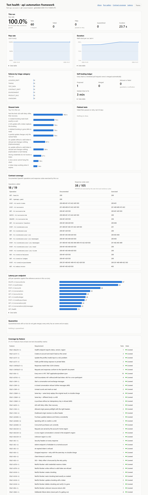
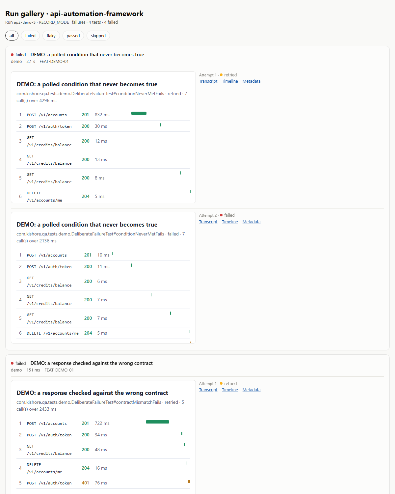
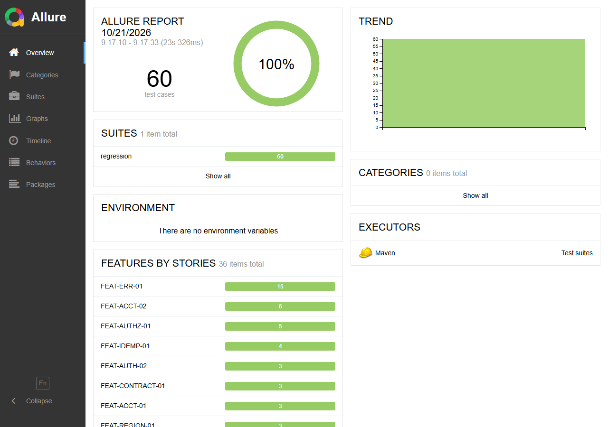

# Reporting

Each layer answers a different question. Screenshots below come from real local runs.

| Layer | Answers | Where it is written | Where CI puts it |
|---|---|---|---|
| Console and TestNG/Surefire reports | Did it pass? | `tests/target/surefire-reports/` | Job log, artifact |
| Step summary | What happened in this run, in one screen? | `reports/site/summary.md` | Job summary and a sticky pull-request comment |
| Health dashboard | Are we healthy, and is it getting better or worse? | `reports/site/index.html` | GitHub Pages (nightly) |
| Run gallery | What did each test do, attempt by attempt? | `run-evidence/…/<run-id>/gallery.html` | Pages, last 10 runs |
| Allure | Every test's steps, attachments, history, categories | `tests/target/site/allure-maven-plugin/` | Pages, `allure/` |
| Failure bundle | Everything about one failed test, in one zip | `run-evidence/…/failure-bundles/` | Artifact |
| Failure report | One page per failure for a person: category, cause, next action | `failure-report.md` in each bundle | Artifact |
| Contract coverage | Which documented operations and response codes did the run exercise? | `reports/site/contract-coverage.md` and the dashboard | Pages |
| Latency | p50 and p95 per endpoint | `reports/site/latency.md` and the dashboard | Pages |

## Making them locally

```bash
./mvnw verify -pl tests -Dsuite=regression
java -jar tools/target/qa-tools.jar triage --run run-evidence/api-automation-framework/<run-id>
java -jar tools/target/qa-tools.jar report --run run-evidence/api-automation-framework/<run-id> --out reports/site
scripts/allure-report.sh [previous-report-dir]      # pass the last report to carry its trend
```

`report` appends the run to `reports/site/data/history.json` (30 runs kept) and also writes the
step summary to `$GITHUB_STEP_SUMMARY` when it runs in Actions.

## Health dashboard

One static file, no server. Light and dark follow the system and can be switched; every chart has a
data table; it works at phone width.



Sections: this run, pass-rate and duration trends, failures by triage category, the healing ledger,
the slowest and the flakiest tests, contract coverage, latency per endpoint, quarantine, and
coverage by feature (the traceability matrix, counted from the `@Feature` annotations so a feature
covered only by a suite that did not run still shows as covered).

Dark mode and phone width: [dark](examples/dashboard/dashboard-dark.png),
[390 px](examples/dashboard/dashboard-390px.png). The same template serves the UI flagship.

## Run gallery

Every test of the run, failures first, with each attempt. An API test has no video: its call
timeline is the replay.



## Allure

Allure 2.39 with the run's environment (run ID, git SHA, targets, JVM, record mode), categories that
mirror the triage rules, and trends carried from the previously published report.



## Failure evidence

With `RECORD_MODE=failures`, a failed test keeps, per attempt:

| File | What it is |
|---|---|
| `transcript.md`, `transcript.json` | Every HTTP call: method, URL, headers, bodies, status, duration, correlation ID, contract violations next to the call that caused them |
| `timeline.html` | The calls on a time axis, coloured by outcome: 2xx green, 4xx amber, errors and 5xx red |
| `error.txt` | The exception and stack |
| `meta.json` | Test identity, features, attempt, environment, git SHA |

The bundle adds a README, `triage.json` and `failure-report.md` after triage, and is zipped. A
sample from a real run is in [examples/failure-evidence](examples/failure-evidence/).

Secrets are masked before anything is written: `Authorization` and cookie headers, token and
password fields, token query parameters.
