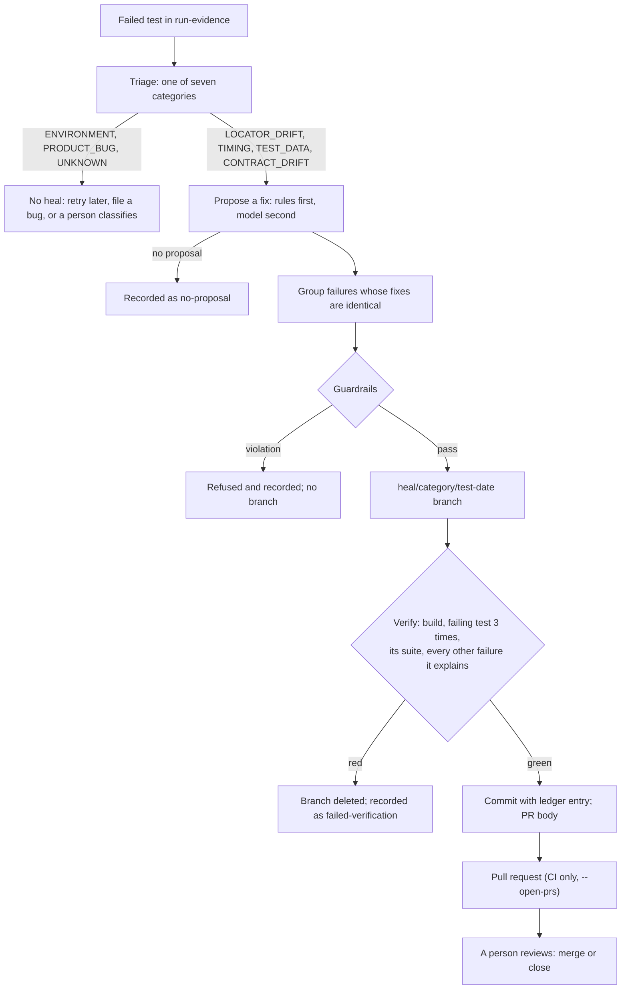

# Self-healing

A failed test can be healed only if its failure is in a healable category, a fix can be proposed,
the fix passes every guardrail, and the fix is proven on its own branch. Then a person reviews the
pull request. Nothing here merges anything.

A real run of the whole pipeline, with every artifact it produced, is in
[examples/self-healing-demo](examples/self-healing-demo/).



## Categories

| Category | Healable | What a fix may look like |
|---|---|---|
| `CONTRACT_DRIFT` | Yes, with a human decision | Rename a field in the violated consumer schema and its client model, when exactly one field went missing and one appeared (rule-based) |
| `TIMING` | Yes | Wait on a condition instead of a fixed time; never a hard wait, never a timeout above 30 s (model only) |
| `TEST_DATA` | Yes | Fix the data fixture: unique data, verified cleanup (model only) |
| `LOCATOR_DRIFT` | Yes | (UI only; no locators here) |
| `ENVIRONMENT` | No | The service or network did not answer; retry later |
| `PRODUCT_BUG` | No | A business assertion failed on a valid response; file a bug with the bundle |
| `UNKNOWN` | No | A person reads the bundle and classifies it |

## Proposing a fix

1. **Rule-based healer** (`RuleBasedHealer`): the one API case with a mechanical fix, a field
   rename. Triage has already written a schema diff (fields missing, fields new). The rename is
   applied to `<schema>.schema.json` and to the `@JsonProperty` of the matching model
   (`balance` → `Balance.java`) only. Another contract that happens to use the same field name is
   left alone.
2. **AI healer** (`AiHealer`), only when `ANTHROPIC_API_KEY` is set and the rules had nothing:
   `claude-opus-5-5`, structured JSON output (the files to change, their new content, a
   rationale), effort `medium`, server-side fallback on a safety decline. It sees the triage
   record (with the failing call) and the framework's main sources and schemas; whatever it
   proposes still goes through the same guardrails as a rule-based fix. A refusal or a
   truncated answer is a "no proposal", never a patch. This step has not run in this project yet
   (see [known issues](known-issues.md)).

## Guardrails (enforced in code, `Guardrails.java`)

**Allowed paths**: `framework/src/main/java/**/{clients,data,auth,config}/**`, the framework's
`config/*.properties`, and `schemas/*.schema.json` for contract drift only.

**Forbidden paths**: `tests/`, anything under `/assertions/`, `pom.xml`, suite XML files,
`.github/`, `sut/`, `postman/`, `tools/`, `docs/adr/`, Checkstyle config, `.mvn/`.

**Forbidden in added lines**: `Thread.sleep` and `TimeUnit…sleep` (hard waits), disabled tests,
`CHECKSTYLE:OFF` and other suppressions, `"additionalProperties": true`, a new empty `catch`, any
timeout above 30 s.

**Forbidden in removed lines**: any check (`assertThat`, `hasStatus`, `matchesContract`,
`Contracts.read`, `isProblem`, `isEqualTo`…). A schema may not require fewer fields than before.

Every rule has a unit test that proves it refuses (`GuardrailsTest`).

## Verification (`Verifier.java`)

On the heal branch, in order, stopping at the first red step:

1. Build the framework with format, lint and `-Werror`.
2. Run the failing test 3 times in a row, retries off.
3. Run the suite it belongs to.
4. Run, once each, the other failures the same fix claims to explain.

## Budgets and records

- At most 3 pull requests per run (`--max-prs`), at most 2 attempts per failure per day.
- Failures with identical fixes share one branch; the pull request lists them.
- `healing-log.json` records every outcome (`proposed`, `rejected-by-guardrails`,
  `failed-verification`) with the guardrail results, the verification and the time to fix. The
  dashboard shows the ledger.
- If anything goes wrong in the middle of a heal, the heal branch is reset, the start branch is
  restored and the heal branch deleted. A heal only starts from a clean working tree.

## Running it

```bash
java -jar tools/target/qa-tools.jar triage --run run-evidence/api-automation-framework/<run-id>
java -jar tools/target/qa-tools.jar heal --run run-evidence/api-automation-framework/<run-id>
# in CI, heal.yml adds --open-prs after a failed nightly
```

To reproduce the demo: start the service with `SUT_CHAOS=rename-balance-field`, run
`-Dsuite=pr-gate`, then the two commands above.
